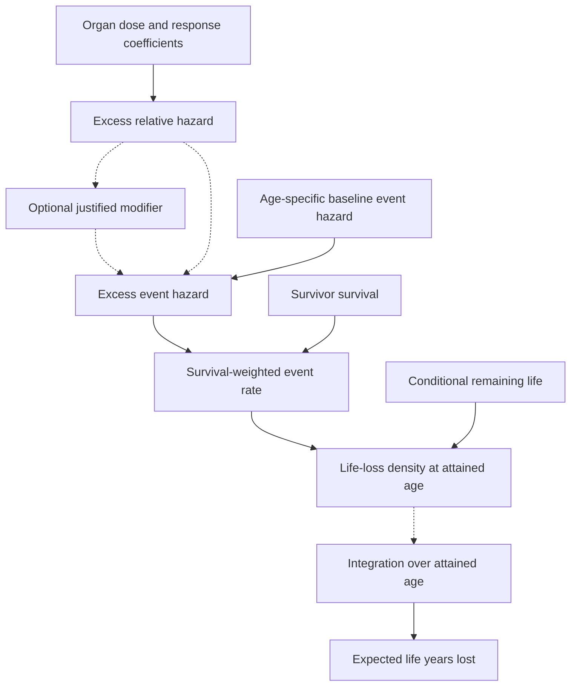
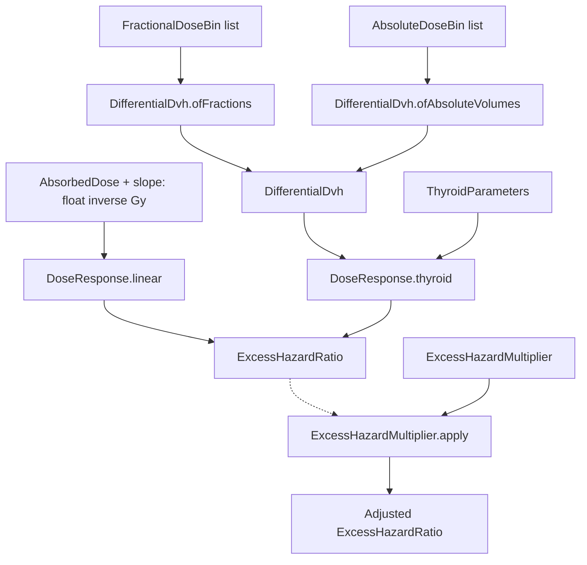
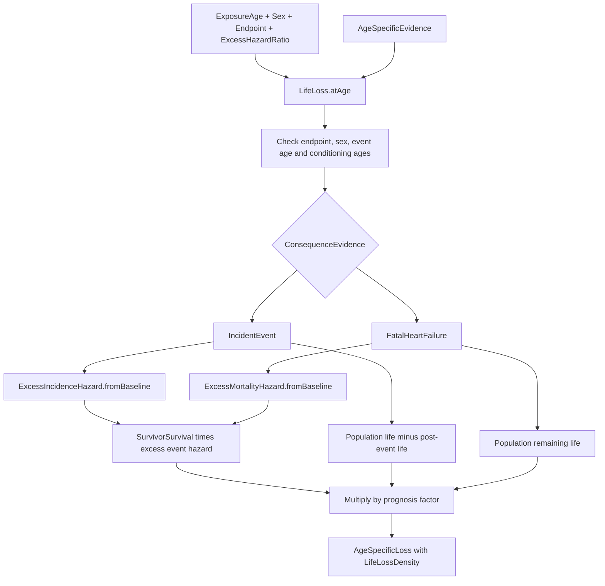
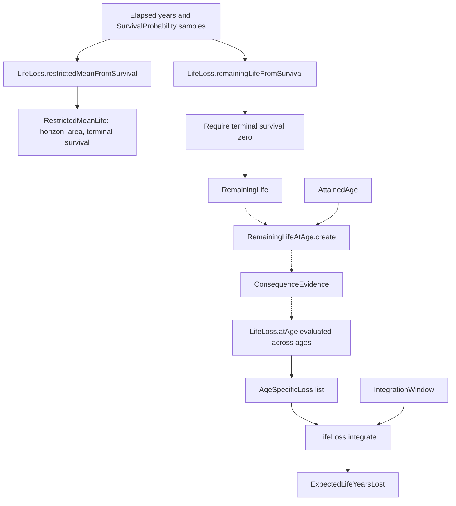

# LYL workflow maps

These maps describe the current domain implementation. They are maintained documentation, checked against the source, rather than automatically extracted call graphs. Solid arrows describe calculation or data flow. Dashed arrows show steps the caller explicitly composes; no end-to-end application workflow currently wires these together.

Scientific reference: Brodin et al., Cancer 2012;118:5432–5440, [DOI 10.1002/cncr.27536](https://doi.org/10.1002/cncr.27536). The maps show our implementation choices for comparison with the article; they do not establish scientific equivalence.

## Scientific overview

For incidence endpoints, the prognosis factor is population remaining life minus post-event remaining life. For the heart-failure mortality pathway, the prognosis factor is population remaining life alone. All prognosis inputs must be conditional on the event age. Neither baseline hazard nor prognosis is inferred from the organ dose.

The optional modifier must be justified for the endpoint, sex and reference. The reported sex comparison is evidence and has no automatic conversion arrow to that modifier.

## Dose-response composition

The generic equations accept supplied coefficients. The publication adapter supplies them through Brodin2012.linearSlope and Brodin2012.thyroidParameters. Brodin2012.unmodifiedExcessHazardRatio dispatches MeanOrganDose to the linear equation and ThyroidDvh to the nonlinear equation. Thyroid response is evaluated per bin before averaging; DifferentialDvh.meanDose is not used for that response.

## Inside LifeLoss.atAge

FatalHeartFailure is accepted only for Linear HeartFailure. That endpoint rejects IncidentEvent. Other endpoints reject the heart-failure mortality pathway. Negative life shortening is rejected by this non-negative loss model.

## Survival inputs and integration

remainingLifeFromSurvival internally calls restrictedMeanFromSurvival. The latter returns a finite-horizon integral with a tail flag; it is not converted to full RemainingLife when terminal survival remains positive. Prognosis curves must start at elapsed time zero with survival one and have strictly increasing times and non-increasing survival.

Integration uses trapezoids on the supplied grid. It requires exact bounds coverage, increasing attained ages, non-increasing survivor survival and matching exposure, sex and endpoint. Excess HR may vary across attained ages. It does not generate samples, interpolate missing bounds, extrapolate tails or calculate joint competing-event probabilities.

## Inputs and outputs

Fallible functions return Result of the output below with string errors.

| Function | Inputs | Output |
| --- | --- | --- |
| DoseResponse.linear | float inverse Gy; AbsorbedDose | ExcessHazardRatio |
| DoseResponse.thyroid | ThyroidParameters; DifferentialDvh | ExcessHazardRatio |
| ExcessHazardMultiplier.apply | ExcessHazardMultiplier; ExcessHazardRatio | ExcessHazardRatio |
| LifeLoss.atAge | ExposureAge; Sex; Endpoint; ExcessHazardRatio; AgeSpecificEvidence | AgeSpecificLoss |
| LifeLoss.integrate | IntegrationWindow; AgeSpecificLoss list | ExpectedLifeYearsLost |
| LifeLoss.restrictedMeanFromSurvival | list of elapsed float years and SurvivalProbability | RestrictedMeanLife |
| LifeLoss.remainingLifeFromSurvival | same survival samples | RemainingLife |
| RemainingLifeAtAge.create | AttainedAge; RemainingLife | RemainingLifeAtAge, directly |

AgeSpecificEvidence contains Endpoint, Sex, Age, SurvivorSurvival and Consequence. IncidentEvent supplies IncidenceHazard and two RemainingLifeAtAge values; FatalHeartFailure supplies MortalityHazard and one RemainingLifeAtAge.

Dose has units Gy; hazards have units inverse year; ratios and survival probabilities are dimensionless. LifeLossDensity has years lost per year of attained age, and integration yields years lost.

## Source ownership

| Module | Responsibility |
| --- | --- |
| Validation and quantity modules in [Units.fs](../src/LifeYearsLost/Units.fs) and [Quantities.fs](../src/LifeYearsLost/Quantities.fs) | Valid numbers, units, hazard algebra and conditioning age |
| [Evidence.fs](../src/LifeYearsLost/Evidence.fs) | Reported associations and supplied modifiers |
| [DoseVolume.fs](../src/LifeYearsLost/DoseVolume.fs) | Valid differential organ volumes |
| [DoseResponse.fs](../src/LifeYearsLost/DoseResponse.fs) | Generic response equations |
| [Brodin2012.fs](../src/LifeYearsLost/Brodin2012.fs) | Publication-specific parameters and response dispatch |
| [LifeLoss.fs](../src/LifeYearsLost/LifeLoss.fs) | Evidence pathways, survival integrals and age integration |

## Joint review procedure

The scientific reviewer checks the overview, both event pathways, prognosis conditioning and integration convention against the article. The code reviewer follows each named function and verifies its inputs, equation, output and error conditions. Record scientific questions in [research questions](research-questions.md).

When changing a signature, pathway or equation, update this map in the same change. The maps intentionally keep validation details outside the scientific overview. This layered convention can be reused in other codebases; this change applies it to the LYL repository.
